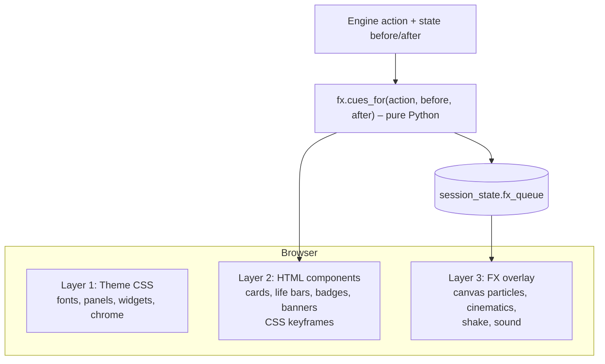

# Final Titan Co-op Companion: Animation & Presentation Design (Step 2)

This is step 2 of the implementation. It assumes step 1 ([webapp-design.md](webapp-design.md)) is already running: a working Streamlit app with an event-sourced engine, the guide, and a plain `st.columns`/`st.image`/`st.dialog` interface.

The app is an **enemy display**. It tracks only the enemy side; player Titans exist only as the count `player_titans_left`. All dice are rolled physically and **no die result is entered**. Every effect in this document therefore happens to an enemy card, the enemy Upgrade row, the queue, or the "Your Titans left" counter.

Goal: the app should feel like a **comic-book fighting game**, not like a dashboard. The rules engine stays exactly as it is. Only the presentation layer changes.

---

## 1. Analysis of the Step 1 Design

### 1.1 What works well
- **Every change is one action, applied by a pure reducer.** `st.session_state.events` is a list of `Action(kind, args)` (`damage`, `heal`, `token`, `flag`, `start_turn`, `fight_end`, `advance_fight`, …). After each action the state also carries `last_reveals`, `hints`, `result`, and numbered `log` entries. Comparing the state before and after one action (plus the action itself) describes each dramatic moment, so animations need no change to the rules code (§5.5).
- **Clear screen structure.** Status bar → guide → enemy Upgrades → arena → queue maps naturally onto comic panels.
- **Defined key moments.** Enemy Titan and Upgrade reveals, Ultimate, final fight, and victory or defeat are already identified as special moments.
- **The guide gives the game a voice.** It can become a narrator caption box and enemy speech bubbles.

### 1.2 What feels like "an ordinary Streamlit app"
| Problem | Cause |
|---|---|
| Default fonts, gray borders, flat widgets | Default Streamlit theme |
| Screen dims and flickers on every click | Full script rerun; elements are marked "stale" |
| Changes happen instantly, without transitions | The final state is rendered; nothing animates the change |
| Reveals are plain dialogs | `st.dialog` with the default style |
| Images are fixed boxes | `st.image` does not allow ids, classes, or 3D transforms |
| Toolbar, "Running…" indicator, hamburger menu | Streamlit chrome |
| The fight screen scrolls like a web page; widgets are stacked in three columns | `st.columns` layout, no fixed stage |
| Cards never move; only the picture in a slot is swapped | Each rerun replaces the image in place |
| Status is shown as progress bars and text | Dashboard widgets instead of a game HUD |

### 1.3 Streamlit constraints to design around
1. **Reruns:** Python re-renders after each interaction. There is no persistent JavaScript state between reruns unless it lives outside the elements that get re-rendered.
2. **Scripts:** `st.markdown(unsafe_allow_html=True)` does not run `<script>`. `components.html` runs scripts, but inside an iframe.
3. **Diffing:** An element whose HTML is unchanged is not remounted, so its CSS animation does not replay. An element whose HTML changed is remounted, and its animation plays again. **This can be used on purpose** (see §5.3).
4. **One-way FX:** JavaScript effects cannot easily send clicks back to Python, unless a bidirectional custom component is used.

---

## 2. Brainstorm: The Comic Fighting-Game Vibe

### 2.1 Visual language
**Dark stage.** Final Titan cards look best on black or very dark backgrounds, so the whole app is a dark "night comic". The card images are always the brightest, most colorful elements on screen. Everything else supports them.

- **Stage:** Near-black background with a very faint halftone vignette at the edges (5–8% opacity) and a subtle noise texture, so it doesn't look flat. Never place bright fills behind card images.
- **Cards:** Shown directly on the dark background without a light frame. Every card on screen is an enemy card, so each gets a thin enemy-red rim light and a soft drop shadow. The arena Titan gets a stronger glow; inactive ones (next enemy, deck, defeated) are dimmed. Player cyan marks the players' side of the UI (PLAYERS badge, YOUR TURN, "Your Titans left").
- **Comic panels:** Dark charcoal panels with a 3–4 px outline in a dim off-white or the side color, a hard offset shadow in a darker shade of the side color (for example `6px 6px 0 #5A1218` for the enemy), and slight rotation (±0.5–1°).
- **Halftone dots:** Ben-Day dot patterns in dark tints of the side colors, used sparingly in panel corners and behind banners, never behind cards.
- **Big lettering:** Headlines and sound effects in a comic display font with a black outline (`-webkit-text-stroke`) and a 3D shadow stack. The bright letters pop strongly against the dark stage.
- **Speed lines and starbursts:** Radial line backgrounds for dramatic moments, drawn in bright colors at reduced opacity. Starburst shapes (`clip-path: polygon`) behind sound-effect words.
- **Accent budget:** Bright yellow, red, and cyan are used for small areas only: the caption box, primary controls, badges, and effects. Large surfaces stay dark.
- **Palette:**

| Role | Color |
|---|---|
| Stage background | `#0A0A0D` |
| Panel | `#16161C` |
| Panel outline (neutral) | `#3A3A46` |
| Text | `#F2EBDD` |
| Dim text | `#9A96A0` |
| Lettering outline | `#000000` |
| Hero yellow (caption box, primary buttons; dark text on it) | `#FFD400` |
| Enemy red | `#E63946` |
| Player cyan | `#00B4D8` |
| Heal green | `#2DC653` |
| Poison | `#8AC926` |
| Fire | `#FF7B00` |
| Blessed gold / Cursed purple | `#FFC300` / `#9D4EDD` |

- **Fonts** (free, OFL-licensed, bundled locally): *Bangers* for sound effects and headlines, *Luckiest Guy* for numbers, *Comic Neue* for readable body text.

### 2.2 Sound-effect vocabulary (onomatopoeia)
All words play on the enemy card, because only damage to the enemy is entered.

| Trigger | Word | Visual |
|---|---|---|
| Damage canceled or reduced to 0 | **WHIFF!** | Gray puff cloud, small |
| Damage 1–2 | **POW!** | Yellow starburst |
| Damage 3–4 | **BAM!** | Orange starburst, card shake |
| Damage 5+ | **KA-BOOM!** | Red starburst, screen shake, debris particles |
| Armor reduced damage | **CLANG!** | Shield icon, "5 → 3" |
| Dodge | **SWISH!** | Card slides sideways, motion blur |
| Minion saved | **NOT TODAY!** | Small minion silhouette pops |
| Heal | **+3** | Green sparkles rising |
| Poison tick | **BLURB** | Green bubbles |
| Fire tick | **SIZZLE!** | Ember particles |
| Charge toggle switched on | **ZZAP!** | Lightning bolt, Charge token flips |
| Charge toggle switched off on the enemy's turn | **ULTIMATE!!** | Full-screen cinematic (§3.2) |
| Blessed/Cursed removed | **POOF!** | Token shatters |
| Enemy Titan defeated | **K.O.!** | Cinematic (§3.2) |
| Fight start | **FIGHT!** | VS splash |

### 2.3 Fighting-game influences
- **Life bar** for the enemy in the style of fighting games: segmented into one pip per Life point. A white "ghost" bar drains behind the real bar after a delay. The bar flashes when hit and pulses at low health. The players' side has no life bar, only the "Your Titans left" counter.
- **VS screen** at the start of every fight: the enemy Titan slides in from the right; the left half shows a cyan "YOUR CHALLENGER" / "YOUR CHAMPION" silhouette panel (the app does not know which player Titan fights). A large **VS** sits in the middle.
- **Turn banners:** "ENEMY TURN" (red) or "YOUR TURN" (cyan) sweeps across the screen.
- **Floating damage numbers** pop out of the enemy card, rise, and fade.
- **Combo counter:** "2 ACTIONS!" appears at the start of an enemy turn when it has Action tokens (1 + Action tokens).

### 2.4 The game's voice
- **Narrator caption box:** The guide panel becomes a yellow, rectangular comic caption box with dark text, one of the few bright surfaces on the dark stage ("Meanwhile, in the arena…" for flavor at Beginner level).
- **Enemy speech bubble:** Generic taunts from the enemy team, never card-specific, such as "Is that all you've got?" or "Next!". They can be turned off.
- **Actor badge:** The guide's actor kinds stay **ENEMY**, **PLAYERS**, and **EVERYONE**. ENEMY becomes a portrait chip with the arena Titan's thumbnail in a red circle; PLAYERS uses a cyan group icon; EVERYONE uses a gray table icon.

### 2.5 Game feel
The app must feel like a game screen, not like a page with widgets. These rules apply everywhere:

- **One fixed screen.** The fight screen fills the viewport and never scrolls on PC (§4). Log, settings, and catalog are separate "menus", not content below the fold.
- **Players left, enemy right.** As in fighting games, the players' side (cyan) is on the left and the enemy side (red) on the right. The arena card faces the players. All motion follows this: the enemy lunges to the left, hits knock it to the right.
- **Cards are physical objects.** A card never just changes in place. It travels between zones (deck → next enemy → arena → defeated pile, hand → Upgrade row), reacts to hits, and is destroyed on K.O. (§3.4, §3.5).
- **Everything is alive.** Idle motion on the board: the arena card floats (±4 px, 4 s loop) and on PC tilts slightly toward the mouse (max. 6°, moving highlight). The next enemy breathes slower and dimmer. Upgrade cards get a glint every few seconds. A flipped Charge token glows in a pulse.
- **Instant input feedback (< 100 ms).** A Streamlit rerun takes 100–400 ms. To hide this, `fx.js` listens to clicks on the command pad in the parent page and starts an **anticipation** at once: the button presses in, an attack streak starts from the command pad toward the arena card, and the card tenses (scale 0.97, leans back). The impact plays when the rerun delivers the cue. If no cue arrives within 800 ms, the card relaxes.
- **Impact juice.** Every hit has hit-stop (the card freezes for 60–140 ms, longer for bigger hits), a one-frame white flash, knockback, and a camera punch (the stage zooms to 102–105% and back). 5+ damage adds screen shake.
- **Easing.** Things that land overshoot and settle (back-out, elastic). Nothing moves linearly.
- **HUD instead of widgets.** "Your Titans left", enemies defeated, and the turn indicator live in a fighting-game HUD at the top; the enemy life bar sits right above the enemy card. No progress bars, no status sentences.
- **Command pad instead of forms.** The damage buttons 1–6 are big round "attack buttons". Heal, Tokens, End fight, and More are icon buttons that open game-style menus that slide in (§4.4) instead of plain popovers.

### 2.6 Ideas parked for later
- Reading physical dice with a camera.
- Hand-drawn character art.
- Music.
- Achievements.

---

## 3. Moment Catalogue

Each moment has a trigger, a duration, and an intensity tier. A trigger is one engine action (`kind` and `args`) together with what it changed between the state before (`b`) and after (`a`) it. **Blocking** moments cover the screen and are dismissed by click or timeout. **Inline** moments play over the board without interrupting anything.

### 3.1 Inline moments (≤ 1.2 s)
| Trigger (action → state change) | Animation |
|---|---|
| `damage`, arena Life dropped by n | Hit reaction (§3.4): hit-stop, knockback and shake (intensity grows with n), red flash overlay, floating `-n`, ghost life bar drains |
| `damage`, Life unchanged and no Dodge used | **WHIFF!** puff, the attack streak misses past the card |
| `damage`, Armor reduced it (`combat.damage_pipeline(...).armor_reduced > 0`) | Shield icon clang, "5 → 3" ticker |
| `damage`, Dodge or Minion count dropped by 1 | Card sways sideways, the token badge pops and disappears |
| `heal` / `life_adjust` with Life raised by n | Green `+n`, sparkles rise, life pips refill one by one |
| `life_adjust` with Life lowered | Same as damage, without the sound-effect word |
| `start_turn`, Life dropped (Poison/Fire) | Bubbles and/or embers from the bottom of the card, then the damage animation; if Fire grew, the Fire badge ticks up |
| `start_turn`, enemy has Action tokens | "2 ACTIONS!" combo counter |
| `token` on any enemy (arena or bench) | The badge scales in with an overshoot, or pops out |
| `flag charged` off → on | **ZZAP!**, lightning bolt, the Charge token flips 180° around the Y axis, glow |
| `flag charged` on → off outside the enemy's turn | Quiet reverse flip (a correction, not an Ultimate) |
| `flag ultimate_form` on | Gold aura around the card, ★ badge slams in |
| `set_starter`, `end_turn` (`active_side` changed) | Diagonal turn banner sweep |
| `last_reveals` contains a Titan with `where == "bench"` | Next-enemy slot: card back flips to the front with a small spark |
| `last_reveals` contains one Upgrade | Card flies from the enemy hand stack into the Upgrade row, flips face up, spark burst, **NEW** sticker slaps on |
| `swap` | The arena card and the bench card trade places on crossing arcs (§3.4) |
| Arena Life ≤ 30% (ongoing, no trigger) | Red pulsing outline and heartbeat scale |

### 3.2 Blocking cinematics (1.5–3 s, skippable)
| Trigger (action → state change) | Cinematic |
|---|---|
| `begin_game` | Title splash "FINAL TITAN — CO-OP" slams in. Difficulty is stamped like a rubber stamp. Then the arena reveal below. |
| `last_reveals` contains a Titan with `where == "arena"` | Screen darkens. The card back flips to the front with a spotlight. The name slams in over a starburst: "A NEW CHALLENGER!" (enemy role Challenger) or "THE CHAMPION AWAITS!" (Champion). Light screen shake. |
| `set_starter` (phase `fight_start` → `combat`) | VS screen (§2.3), then **FIGHT!**, then the turn banner for the starting side |
| `flag charged` on → off while `active_side == "enemy"` | **Ultimate.** Short red flash (max. 60% opacity, so it doesn't glare on the dark stage), radial speed lines, the enemy card zooms to center with heavy shake, **ULTIMATE!!** letters rise in, and energy particles burst. The guide then says "Read the Ultimate on the card." |
| `result.reason` in `enemy_defeated` / `both_defeated` | Freeze frame, **K.O.!** in giant letters, then one of the destroy animations (§3.5). The remains fly to the defeated pile and the next "Enemies defeated" pip fills with a burst. |
| `player_titans_left` dropped | Slower and more somber: the screen goes briefly grayscale, one pip of the "Your Titans left" counter cracks, and the caption reads "One of your Titans has fallen…" |
| `result.reason == "enemy_returned"` | The enemy card slides back into the next-enemy slot, **RETREAT!** |
| More than one Upgrade in `last_reveals` (final fight) | Red alert stripes, **FINAL FIGHT** banner. The remaining enemy Upgrades fan out from the hand and land in the row one after another. |
| `phase` becomes `victory` | Comic splash page: **VICTORY!**, confetti, a summary panel (fights, K.O.s, Ultimates, damage dealt) |
| `phase` becomes `defeat` | Red ink splatter spreads over the dark stage, **GAME OVER** in dripping letters, summary panel, and a "Try again" button |

### 3.3 Sequencing rules
- Effects for one action play in a fixed order on a **timeline**: start-of-turn ticks → damage/heal → token changes → Charge/Ultimate → fight end (K.O., player loss) → phase end (victory/defeat). Reveals from `advance_fight` play Upgrades first, then the arena Titan, matching the engine order.
- Inline effects may overlap by up to 150 ms. Blocking cinematics wait until the effects before them have finished.
- Any click or the space bar skips the current cinematic and finishes the rest of the timeline instantly.
- The board under the effects always shows the **final state**. Effects are decoration and never hold rules information.

### 3.4 Card motion
Every card on screen has a home **zone**: deck stack, next-enemy slot, arena, defeated pile, enemy hand stack (face-down Upgrades), and Upgrade row. When the state moves a card to another zone, the card visibly travels there. When something happens to a card in place, the card itself reacts.

| Trigger | Motion |
|---|---|
| `damage`, Life dropped | Attack streak from the command pad side hits a random point on the card. Hit-stop, then knockback 12–40 px to the right and 2–6° rotation away from the hit (scaled by damage), spring back with overshoot. 5+ damage: crack decal over the card for the rest of the animation. |
| `damage`, Dodge used | Quick sidestep up and right with 2–3 fading afterimages, then back. |
| `damage`, Minion used | A small Minion token jumps in front of the card, takes the hit, and pops. |
| `damage`, WHIFF | The card leans aside slightly; the streak flies past. |
| `start_turn` on the enemy side | The enemy **steps forward**: lunge 30 px to the left, scale 1.05, red glow pulse, then back. |
| `heal` | The card lifts 8 px, glows green, and settles. |
| `flag charged` on | The card crouches (scaleY 0.96), then straightens with an electric outline. |
| Ultimate (§3.2) | The card flies to screen center, grows to 1.6×, holds during the lettering, then slams back into the arena with a dust burst. |
| Arena Titan revealed from the bench | The next-enemy card flies on an arc from its slot into the arena, grows, and lands with a dust burst and light shake. If the bench is refilled, a card slides out of the deck stack into the next-enemy slot and flips in flight. |
| Arena Titan revealed from the deck | The card leaves the deck stack face down, flips in flight, and lands in the arena. |
| Upgrade revealed | The card flies from the hand stack to its grid slot and flips in flight; the other Upgrades shift to make room. |
| Enemy defeated | Destroy animation (§3.5); a small gray copy then flies to the defeated pile. |
| `enemy_returned` | The arena card slides back into the next-enemy slot; the card that was there is pushed back onto the deck stack. |
| `swap` | Both cards travel on crossing arcs; the one moving into the arena passes in front and grows. |
| `player_titans_left` dropped | The arena card does a short victory pose (rises, glows), while one "Your Titans left" pip cracks. |

**How cards move across reruns (FLIP):**
1. Every card element carries `data-fx-id="card-<card_id>"`, independent of its zone. Every zone carries `data-fx-zone` (`deck`, `next-enemy`, `arena`, `graveyard`, `hand`, `upgrades`). This lets `fx.js` find the same card in its new zone after a rerun.
2. After each render, `fx.js` records the bounding box of every `data-fx-id` and `data-fx-zone` element in `window.parent.__ftFx.rects` (`MutationObserver` + `requestAnimationFrame`).
3. A `move` cue (`Cue(kind="move", target="card-<id>", params={"from": "next-enemy", "to": "arena", "flip": False})`) takes the **old** box from the cache (or the `from` zone if the card was not on screen, such as the deck), and the **new** box from the DOM. It hides the real element (`visibility: hidden`), animates a sprite (a cloned `` with a card back as backface) in the overlay from the old to the new box with the Web Animations API (translate on an arc, scale, rotate, `rotateY` for flips), and then shows the real element and removes the sprite.
4. In-place reactions (knockback, lunge, crouch) run directly on the real element with `element.animate()`. The cue is played after the render that carries it, so the element is not remounted during the animation.
5. Fallback without the overlay: Layer 2 CSS keyframes on the element only (slide in, flip in place), no travel between zones.

### 3.5 Card destroy animations (K.O.)
A defeated enemy Titan is destroyed on screen. There are three styles, so repeated K.O.s don't look the same. All run on a canvas in the FX overlay, using the card image (served from the same origin, so the canvas is not tainted). The real card element is hidden while the destroy animation runs on top of its last box.

| Style | Look | Duration |
|---|---|---|
| **SLASH** (cut in pieces) | 1–3 bright blade lines flash diagonally across the card (**SHING!**), hit-stop 150 ms. The card splits along the cut lines into 2–4 polygon pieces, which slide apart along the cut direction, then rotate, fall with gravity, and fade. Sparks fly from the cut edges. | ~1.2 s |
| **DISSOLVE** (burn away) | A noise mask eats the card from one corner. The burning edge glows (orange for Fire, green for Poison, purple ash otherwise), and pixels along the edge are emitted as embers or ash rising up. | ~1.5 s |
| **SHATTER** (explode into shards) | Cracks spread from the impact point (200 ms), then the card breaks into 20–40 triangular shards that fly outward with fake 3D spin (`scaleX` flipping), gravity, and fade. White flash, debris particles, strong screen shake. | ~1.3 s |

**Technique:**
- *Slash:* cut lines are precomputed as polygons; each piece is drawn with `ctx.clip()` and its own transform.
- *Dissolve:* a precomputed noise texture (`noise.png`) is thresholded each frame and applied with `globalCompositeOperation = "destination-out"`. A second, slightly lower threshold band is drawn in the glow color for the burning edge. Edge pixels feed the particle system.
- *Shatter:* random split triangles (or a small Delaunay triangulation) around the impact point, each drawn clipped from the card image.
- All styles respect the particle cap from §5.4.

**Which style plays** is chosen in `cues_for` (pure Python, deterministic, tested) and stored in the cue params:

| Situation | Style |
|---|---|
| Killed by a Fire tick at `start_turn` | Dissolve, orange embers |
| Killed by a Poison tick at `start_turn` | Dissolve, green acid bubbles |
| Killing blow of 5+ damage, or the last enemy of the game | Shatter (the last enemy also plays in 0.5× slow motion) |
| Killing blow of 1–4 damage | Slash, with `min(3, damage)` cuts |
| `fight_end` chosen by hand, without a Life change | Rotates Slash → Dissolve → Shatter by fight number |

The "K.O. style" setting (§5.8) can force one style or pick at random. With reduced motion, the card only desaturates and fades (400 ms).

**Order within the K.O. cinematic:** freeze frame → **K.O.!** lettering slams in → destroy animation → a small gray copy flies to the defeated pile → the "Enemies defeated" pip fills.

### 3.6 Parked destroy styles
- *Turn to stone:* the card grays, cracks, and crumbles to the bottom.
- *Ink splash:* the card bursts into comic ink drops.

---

## 4. Fight Screen Layout

### 4.1 Principles
- **Size hierarchy:** arena Titan ≫ enemy Upgrades > next enemy > deck / defeated pile. The arena card must stay readable at full size (≥ 600 px tall on a 1080p screen).
- **Sides:** players' side left (caption box and command pad: what the players read and do), the arena in the center, the enemy side right (next enemy, deck, Upgrades, hand). On mobile, the same order runs top to bottom.
- **Controls in the hand/thumb zone:** PC left column below the caption box; mobile at the bottom, always visible.
- **The HUD carries the game status** (Titans left, enemies defeated, turn, fight number, enemy name, Armor, Speed). The enemy life bar sits directly above the arena card, next to the Titan it belongs to, so hits and the draining bar are seen together.
- **Zoom instead of size:** small cards (Upgrades, next enemy, defeated) enlarge to full size on hover (PC) or tap (mobile, as a full-screen lightbox).

### 4.2 PC, 16:9 (reference 1920 × 1080, scales with the viewport)
Columns ≈ 27% / 40% / 33%; rows: HUD ≈ 9%, stage ≈ 87%, log ticker ≈ 4%. No scrolling.

```text
+-------------------------------+-------------------------------------+----------------------------------+
| HUD: PLAYERS (cyan)           | FIGHT 3    >> ENEMY TURN <<         | HUD: ENEMY (red)                 |
| YOUR TITANS  (o)(o)( )        | DEFEATED  [X][X][ ][ ][ ]           | ROLE: CHALLENGER                 |
| [Undo] [Menu]                 |                                     | CRIMSON KNIGHT  ARM 1  SPD 4     |
+-------------------------------+-------------------------------------+----------------------------------+
| CAPTION BOX (guide)           |           LIFE [######....] 6/10    | NEXT ENEMY        DECK  DEFEATED |
| [ENEMY] Roll for the enemy!   |   +-----------------------------+   | +-----------+     +--+    +--+   |
| 2 Actions - resolve each die. |   | [ARM+1]                     |   | |   next    |     |##|    |xx|   |
| [ ] checklist item            |   | [POI 2]                     |   | |   titan   |     |##|    +--+   |
| [ ======== NEXT > ======== ]  |   |                             |   | |  (small)  |     +--+     2/5   |
|                               |   |         ARENA TITAN         |   | +-----------+       4            |
| ----------------------------- |   |   hero card, ~70% of the    |   |                                  |
| COMMAND PAD                   |   |   stage height, readable    |   | ENEMY UPGRADES     hand [##] x3  |
| DAMAGE TO THE ENEMY           |   |                             |   | +-------+ +-------+ +-------+    |
| (1) (2) (3) (4) (5) (6) (..)  |   |   idle float, hit reaction, |   | |  upg  | |  upg  | |  upg  |    |
|                               |   |   floating numbers, K.O.    |   | |       | |       | |       |    |
| [Heal]        [Tokens]        |   |                             |   | +-------+ +-------+ +-------+    |
| [End fight]   [More]          |   |                       (CHG) |   | +-------+ +-------+ +-------+    |
|                               |   +-----------------------------+   | |  upg  | | NEW!  | |       |    |
|                               |    tokens on the left edge,         | |       | |       | |       |    |
|                               |    Charge token bottom right        | +-------+ +-------+ +-------+    |
|                               |                                     | hover = zoom to full size        |
+-------------------------------+-------------------------------------+----------------------------------+
| LOG TICKER > Crimson Knight took 4 damage (5 - Armor 1).                                               |
+--------------------------------------------------------------------------------------------------------+
```

- **Arena (center):** the enemy life bar directly above the card, the hero card, token badges stacked along its left edge (facing the players), Charge token on its bottom-right corner. The enemy speech bubble pops out of the card's top-left corner for a moment and overlaps the stage, not the life bar. Floating numbers, hit reactions, and destroy animations play here.
- **Enemy side (right):** next-enemy card (≈ 40% of the arena card height) with deck stack and defeated pile next to it. Below, the Upgrade grid with 3 columns (4 columns and smaller cards once more than 6 are active, e.g. in the final fight). The face-down hand stack sits at the top of the grid as the spawn point for reveals.
- **Players' side (left):** caption box on top with the primary "NEXT" button, command pad below. Menus (Heal, Tokens, More) slide in from the left over this column, so the arena stays visible.
- **Log ticker (bottom):** the latest log entry, scrolling in. Click opens the full battle log.

### 4.3 Mobile, portrait (reference 390 × 844)
Rows: HUD ≈ 9%, stage ≈ 42%, Upgrade strip ≈ 12%, caption ≈ 12%, command pad ≈ 25%. The command pad sticks to the bottom; if the guide text is longer, the caption box opens as a bottom sheet over the stage.

```text
+------------------------+---------------+
| CRIMSON KNIGHT         | ENEMY TURN    |
| CHALLENGER ARM 1 SPD 4 | F3  DEF 2/5   |
| TITANS (o)(o)( )       | [Undo] [Menu] |
+------------------------+---------------+
| LIFE [######....] 6/10 | NEXT ENEMY    |
| +--------------------+ | +---------+   |
| |                    | | |  next   |   |
| |    ARENA TITAN     | | |  titan  |   |
| |   ~60% of width    | | +---------+   |
| |                    | | DECK 4        |
| |  tokens, Charge    | | [##]          |
| |  token, hits, K.O. | |               |
| |                    | |               |
| +--------------------+ |               |
+----------------------------------------+
| ENEMY UPGRADES   hand [##] x3          |
| [upg][upg][upg][NEW][upg] >            |
| (swipe; tap = zoom)                    |
+----------------------------------------+
| CAPTION BOX (guide, 2-3 lines)         |
| [ENEMY] Roll for the enemy!  [v]       |
+----------------------------------------+
| COMMAND PAD (sticky, thumb zone)       |
| (1) (2) (3) (4) (5) (6) (..)           |
| [Heal] [Tokens] [End] [More]           |
| [ ========== NEXT > ========== ]       |
+----------------------------------------+
```

- The enemy life bar sits directly above the arena card, as on PC. The arena card takes ≈ 60% of the width; the next enemy and deck share the narrow column to its right. The defeated count moves into the HUD.
- Upgrades become a horizontal strip of small cards (swipe), with the hand stack at its left end. Tap opens a card full screen.
- Menus (Heal, Tokens, More) open as bottom sheets over the command pad.
- Phone in landscape uses the PC layout, scaled down.

### 4.4 Building the layout in Streamlit
- Each region is a keyed container rendered in one flat order: `st.container(key="hud")`, `stage`, `side` (next enemy, deck, defeated), `upgrades`, `caption`, `pad`, `ticker`. The DOM order is the mobile reading order, which also gives a sensible tab order.
- `comic.css` turns their common parent block into a CSS grid (selected with `:has(> .st-key-stage)`) and places the regions with `grid-template-areas`. A media query (`(orientation: portrait) and (max-width: 820px)`) switches the areas, so the same DOM gives both layouts. `st.columns` is not used for the main layout, which also avoids Streamlit's automatic column stacking on narrow screens.

```text
PC:      "hud     hud    hud"          Mobile:  "hud      hud"
         "caption stage  side"                  "stage    side"
         "pad     stage  upgrades"              "upgrades upgrades"
         "ticker  ticker ticker"                "caption  caption"
                                                "pad      pad"
```

- The grid has `height: 100dvh` and `overflow: hidden` on PC. Regions use `min-height: 0`; card images use `object-fit: contain` with a `max-height` from their grid row, so cards scale with the viewport instead of pushing content down.
- Heal, Tokens, and More popovers are restyled as slide-in sheets: from the left edge on PC, from the bottom on mobile.
- Zones carry the `data-fx-zone` attributes used by card motion (§3.4).

---

## 5. Implementation Approach in Streamlit

### 5.1 Layered architecture


| Layer | Technology | Responsible for |
|---|---|---|
| 1. Theme | `.streamlit/config.toml` + one global `<style>` injected once | Fonts, colors, comic panel style for containers, buttons, dialogs, hiding Streamlit chrome |
| 2. HTML components | `st.markdown(unsafe_allow_html=True)` / `st.html` with templates + CSS keyframes | Cards, 3D flips, life bars, token badges, banners, inline animations played once per action |
| 3. FX overlay | One `components.html` element that injects a full-screen, click-through overlay into the parent page | Particles, screen shake, cinematics, floating numbers, sound |

### 5.2 Layer 1: Theme and chrome
- `config.toml` (already exists with a dark theme in an orange/gray palette from step 1; replace its values):
  - Set `theme.base = "dark"` and the theme colors from §2.1 (stage background, panel as secondary background, off-white text, yellow primary).
  - Turn on `server.enableStaticServing = true`, so fonts, images, sounds, and JavaScript are served from `static/` under `/app/static/...`.
  - Set `client.toolbarMode = "minimal"`.
- The global stylesheet is `presentation/assets/comic.css`, loaded once per rerun via `st.markdown("<style>…</style>")`. It replaces the step 1 `components.CSS` block and keeps its layout rules (`st-key-enemy_card`, `st-key-upgrade_grid`, `st-key-next_enemy`, `st-key-queue_small`, click-through `st-key-card_*`). It:
  - Loads fonts with `@font-face` from `/app/static/fonts/` (no external CDN).
  - Restyles `[data-testid="stVerticalBlockBorderWrapper"]` as comic panels, `stButton` as chunky offset-shadow buttons with press-down on `:active`, and `stDialog` as a dark comic page over a dimmed backdrop (85% black), so revealed cards stand out.
  - Hides the header, footer, decoration, and status widget.
  - **Removes stale dimming**: `[data-stale="true"] { opacity: 1 !important; transition: none; }`, so reruns no longer flicker.
- Streamlit's `data-testid` selectors are internal and may change. Keep all of them in one CSS section, with the tested Streamlit version written above it.

### 5.3 Layer 2: HTML components and "animate once per action"
**Principle: render the final state, animate from the previous state.**
Every animated element contains the number of the action that last changed it (`GameState.event_count` at that time), plus the value before the change:

```html
<div class="ft-card enemy shake-3" data-fx="act-142" data-fx-target="enemy-card">
  
  <div class="ft-life" style="--from: 0.7; --to: 0.4; --pips: 10"></div>
</div>
```

- When the action number changes, the HTML string changes, so Streamlit remounts the element and the CSS animation plays **exactly once**. On unrelated reruns, the HTML string stays the same, so nothing replays.
- The engine does not store "last changed by" per element, so `render.py` gets it from the cue pipeline: `session_state.fx_marks` maps a target (`enemy-card`, `life`, `badge-<token>`, `upgrade-<id>`, …) to `(action_no, before_value)`. It is updated only when cues are produced, and reset on undo or load (§5.5).
- The life bar animates from `--from` to `--to` with `@keyframes`. The ghost bar uses the same keyframes with a 400 ms delay.
- Card images are rendered as `` from static serving instead of `st.image` (step 1 uses `ui/images.thumb()` + `st.image`), which makes ids, classes, 3D `transform`, and `filter` possible. Thumbnails are generated once in a build script.
- Templates live in `presentation/templates/*.html` (Jinja2-like `string.Template`). **Every dynamic text value is passed through `html.escape`**, and numbers are cast to `int`. Only catalog ids from a whitelist are used in image paths.
- Interactive controls (buttons, pickers) stay native Streamlit widgets that are only restyled. This keeps the two-way data flow simple.

### 5.4 Layer 3: FX overlay
A single component, rendered once near the top of the page:

```python
def fx_layer(cues: list[Cue], settings: FxSettings) -> None:
    payload = json.dumps({"cues": [c.to_dict() for c in cues], "settings": asdict(settings)})
    components.html(FX_HTML.replace("__PAYLOAD__", payload.replace("</", "<\\/")), height=0)
```

The JavaScript inside (`presentation/assets/fx.js`):
1. On first load, creates a `<div id="ft-fx-root">` with a full-screen `<canvas>` in `window.parent.document.body` (`position: fixed; inset: 0; pointer-events: none; z-index: 9999`). The root survives reruns because Streamlit does not manage it.
2. Keeps a set of played cue ids in `window.parent.__ftFx.seen`. Cues that were already played are ignored, which also protects against double rendering.
3. Plays cues on a timeline:
   - **Positioned effects** find their target with `parent.document.querySelector('[data-fx-target="enemy-card"]')` and use its `getBoundingClientRect()`.
   - **Particles** use a small custom canvas particle system (sparks, embers, bubbles, confetti, debris), capped at about 300 particles and driven by `requestAnimationFrame`.
   - **Cinematics** are DOM overlays (big lettering, speed lines, starbursts) with CSS keyframe animations. During blocking cinematics, `pointer-events: auto` is on so that a click skips.
   - **Screen shake** adds a class to `.stApp` for the shake duration.
   - **Sound** uses `HTMLAudioElement` from `/app/static/sfx/`. It is muted by default and unlocked after the first user click.

**Risk and fallback:** Accessing `window.parent` from the component iframe depends on Streamlit's current same-origin iframe setup and is not an official API.
- All parent-page code is kept in `fx.js`, and `fx_layer` is the only call site.
- If `window.parent.document` is not accessible, the layer falls back to playing cinematics inside a `st.dialog`, and inline effects use only Layer 2 CSS.
- Later upgrade path: rewrite as a proper bidirectional custom component, which also allows "click to continue" callbacks to Python.

### 5.5 Cue pipeline (Python)
The engine emits no event objects; it applies `Action(kind, args)` to a `GameState`. Cues are derived from the action and the state change it caused, so the engine stays untouched.

```python
@dataclass(frozen=True)
class Cue:
    id: str            # "act-142-0": action number + position, unique and stable
    kind: str          # "damage", "ko", "reveal_titan", "ultimate", ...
    target: str | None # "enemy-card", "next-enemy", "upgrade-row", "titans-left", "screen"
    params: dict       # {"amount": 5, "word": "KA-BOOM!"}
    blocking: bool
    duration_ms: int
```
- `presentation/fx.py: cues_for(action: Action, before: GameState, after: GameState) -> list[Cue]` is a **pure function** with unit tests. It compares arena Life, statuses, `charged`, `active_side`, `phase`, `player_titans_left`, and `defeated`, and reads `after.last_reveals` and `after.result`. Armor reduction is recomputed with `combat.damage_pipeline` from the `damage` args. Example: a `damage` action that lowers Life by 5 becomes `[Cue(kind="shake", …), Cue(kind="float_number", …), Cue(kind="sfx_word", word="KA-BOOM!")]`.
- `ui/session.dispatch` already appends one action and rebuilds the state. It also keeps the previous state, calls `cues_for` for the new action, and stores the result in `session_state.fx_queue`.
- `st.session_state.fx_cursor` stores the number of actions already turned into cues. Only actions after the cursor become cues.
- **Undo, load, and new game** set the cursor to `len(events)` and clear `fx_marks` without creating cues, so history never replays as animation.
- The sound-effect word tables (§2.2) and taunts are in `presentation/data/fx.yaml`.

### 5.6 Reducing rerun flicker
- **`st.fragment`** for the arena and the combat buttons: an action inside the arena reruns only that fragment, which keeps the FX overlay and the rest of the page stable.
- Stable element keys and fixed heights for card containers prevent layout jumps.
- Cinematics cover the screen while the new state is rendered underneath.
- The step 1 reveal dialog (`_reveal_dialog`) is replaced by the reveal cinematics; with the overlay unavailable it stays as the fallback.

### 5.7 Enemy turn and Charge
All dice are rolled physically and no result is entered, so there is nothing to animate for the roll itself. The presentation instead makes the enemy turn feel like a fighting-game round.
- **Waiting state:** During the `enemy_turn` guide step, the caption box shows "ROLL FOR THE ENEMY!" with a small bouncing die icon and the number of Actions (1 + Action tokens). The caption box gets a red halftone background on the enemy's turn, so it's clear the players are rolling for the enemy.
- **Blessed or Cursed:** The badge shows two small dice and a label ("Blessed – ENEMY picks", "Cursed – YOU pick"). Removing the token plays **POOF!**.
- **Charge token:** The "Charge flipped" toggle under the enemy card is restyled as a round two-sided token (gray face / glowing face). Switching it on plays **ZZAP!** (§3.1). While it is on, "ULTIMATE READY" pulses.
- **Ultimate:** By convention, switching Charge off during the enemy's turn means the Ultimate fired (this is what the guide tells the players to do). It plays the Ultimate cinematic. Switching it off at any other time is treated as a correction and only reverse-flips the token.

### 5.8 Settings
| Setting | Options | Default |
|---|---|---|
| FX intensity | Off / Low (no particles, no shake) / Full | Full |
| Cinematics | Always / Key moments only / Off | Key moments only |
| Animation speed | 0.5× / 1× / 1.5× / 2× (multiplies all durations) | 1× |
| Sound | On / Off, volume | Off |
| Enemy taunts | On / Off | On |
| K.O. style | Auto (§3.5) / Random / Slash / Dissolve / Shatter | Auto |
| Idle motion and mouse tilt | On / Off | On |
| Reduced motion | Follows `prefers-reduced-motion`; can be forced | System |

Reduced motion replaces shakes, flips, and particles with short fades. The instruction panel and all rules information never depend on animation.

---

## 6. Module Structure (additions to step 1)
```
static/
  fonts/      Bangers.woff2  LuckiestGuy.woff2  ComicNeue-*.woff2
  cards/      titans/ upgrades/ legendary/ backs/   (moved from assets/, + thumbs/)
  sfx/        pow.mp3 bam.mp3 whiff.mp3 zap.mp3 ko.mp3 ...
  fx/         fx.js  motion.js  destroy.js  fx.css  textures/halftone.png  noise.png
presentation/
  theme.py         # inject_theme(): global CSS + fonts + fight-screen grid, once per rerun
  layout.py        # fight_screen(): keyed regions hud/stage/side/upgrades/caption/pad/ticker
  templates/       # card.html, lifebar.html, badges.html, banner.html, charge_token.html, caption.html, titans_left.html
  render.py        # card_html(titan, catalog, marks) etc., escaping, whitelist
  fx.py            # Cue, cues_for(action, before, after)  – pure, tested
  fx_layer.py      # fx_layer(cues, settings) – components.html wrapper
  data/fx.yaml     # SFX words, thresholds, taunts, durations
.streamlit/config.toml   (exists; new values)
tests/test_fx.py  tests/test_render.py
```
The step 1 UI swaps `ui/components.py` helpers (`life_bar`, `token_badges`, `actor_badge`, `card_image`, `CSS`) and `st.image` for `render.*` calls, and calls `fx_layer` once per page. `ui/session.dispatch`, `undo`, and loading get the cursor handling from §5.5. `ui/arena_page.py` replaces its `st.columns` layout with the keyed grid regions from §4.4. The engine and guide stay unchanged.

---

## 7. Step 2 Milestones

| # | Milestone | Acceptance criteria |
|---|---|---|
| 2.1 | **Theme and chrome** | Dark stage, comic fonts, colors, and panels; cards are the brightest elements on screen; restyled buttons and dialogs; Streamlit chrome hidden; no stale dimming on rerun |
| 2.2 | **Fight screen layout** | PC 16:9 and mobile portrait layouts from §4 built from one DOM with CSS grid areas; no scrolling on PC; HUD replaces progress bars; command pad and slide-in menus; hover/tap zoom on small cards |
| 2.3 | **HTML card components** | Cards served from static files with comic frames; enemy life bar with pips and a ghost bar; token badges; Charge token; "Your Titans left" pips; guide panel as caption box with actor badge (enemy portrait / players / everyone) |
| 2.4 | **Animate once per action** | Life bar, badge, flip, and shake animations play exactly once per engine action and never on unrelated reruns, undo, or load |
| 2.5 | **FX overlay and cue pipeline** | `cues_for(action, before, after)` unit tested; overlay survives reruns; floating numbers and sound-effect words appear at the right target; fallback works with the overlay disabled |
| 2.6 | **Card motion** | Idle motion; anticipation on click before the rerun; hit reaction with hit-stop and knockback; enemy lunge on its turn; cards travel between zones with FLIP sprites (bench → arena, deck → bench, hand → Upgrade row, swap, retreat) without visible jumps |
| 2.7 | **Combat effects** | Enemy-turn waiting state; damage tiers, WHIFF, Armor, Dodge, Minion, heal, Poison/Fire ticks, Action combo counter, token badges, Charge flip, turn banners, low-health pulse |
| 2.8 | **Cinematics and K.O.** | Arena reveal, VS/FIGHT, Ultimate (Charge-off convention), K.O. with the Slash, Dissolve, and Shatter destroy animations and the style selection from §3.5 (unit tested), player Titan lost, retreat, final fight, victory, game over; all skippable; timeline order correct |
| 2.9 | **Sound, settings, accessibility** | All settings from §5.8 work; reduced motion is respected; sound is off by default and can be enabled |
| 2.10 | **Polish and performance** | 60 fps on a mid-range laptop with Full FX; particle cap respected; no layout jumps; a full game can be played with FX Off |

### Non-goals for step 2
- No changes to rules, the engine, or the guide. Cues come from actions and state diffs only.
- No die input, no player cards.
- No online multiplayer.
- No WebGL or game engine. Everything is CSS, canvas 2D, and small vanilla JavaScript.

## 8. Open Points
- Pin a Streamlit version and record the `data-testid` selectors the theme relies on.
- Confirm that the pinned Streamlit version keeps keyed containers as siblings in one block, so the CSS grid from §4.4 can place them (`:has()` is needed; all current browsers support it).
- Confirm that the `components.html` iframe can access the parent document in the pinned version. Otherwise start directly with a bidirectional custom component for Layer 3.
- Sound effects need a license-free source, or should be self-made.
- The Ultimate cinematic relies on the convention "Charge off during the enemy's turn = Ultimate". If that misfires in play, add an explicit "Ultimate!" button next to the Charge toggle, which would need a new engine action.
