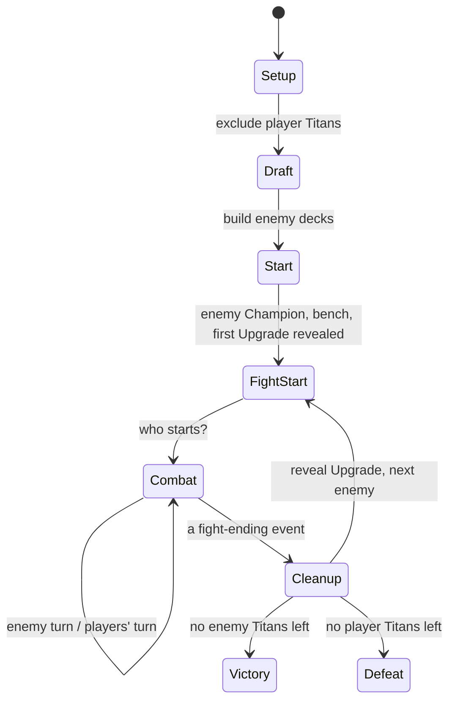

# Final Titan Co-op Companion: Web App Design

## 1. Purpose and Scope

A Streamlit web app that plays the **enemy team** in Final Titan Solo & Co-op mode ([final-titan-coop-rules.md](final-titan-coop-rules.md)). The app is an **enemy display**: one screen that shows everything about the enemy at a glance, the current enemy Titan, its Life and tokens, the active enemy Upgrades, and the enemies still to come.

The players handle their own side entirely with the physical game: their Titans, Life tokens, Status tokens, Upgrade hands, and turns. The app does not track any player card. It only needs to know:

- which Titans the players drafted, so they are **excluded from the enemy deck**, and
- how many player Titans are still alive, to detect defeat.

**All dice are rolled physically**, including the enemy's rolls. The app never rolls dice and **never asks for die results**. Players roll for the enemy, look the result up on the enemy card, and resolve it. Only what the rules need to track (Life, tokens, Charge) is entered with the controls.

### In scope
- The enemy side of every generic rule: queue order, Upgrade reveals, Charge/Ultimate, Status tokens, start-of-turn damage, the damage order for damage the enemy takes, fight clean-up, and win/loss detection.
- Showing all enemy cards as images, so the enemy needs no physical cards.
- **Guided play:** at every step the app says what to do next (§5).

### Out of scope
- **Player cards.** No Life, tokens, Speed, or Upgrades of player Titans. No player names or per-player benches.
- **Card and Titan effects.** The app never interprets card text. Players read the images and apply effects with the controls.
- Online multiplayer. One shared screen per table.

### Guiding principle
Show the enemy perfectly on one screen. Automate what the rulebook defines in general terms for the enemy; leave everything printed on cards to the players; every change can be undone.

## 2. Card Catalog

### 2.1 Assets
```
assets/
  titans/<id>.jpg            # Titans the enemy may use
  titans/noCoop/<id>.jpg     # Titans the enemy cannot use (draftable by players)
  titans/finalTitanCardBackside.jpg
  upgrades/<id>.jpg          # one file per physical copy (powerPotion2.jpg, …)
```
Only cards with an image are part of the game.

### 2.2 Metadata
Generated from the English rows of `assets/Final Titan Card Database.csv` by `finaltitan/build_catalog.py`, matched to the image files.

`data/titans.csv`: `id, name, max_life, speed, armor, team_power, advanced, enemy_usable, legendary_id, expansion`
`data/upgrades.csv`: `id, name, advanced, enemy_usable, legendary, expansion`

### 2.3 Catalog editor
A page shows each image next to its metadata with next/previous navigation and validation (missing images, duplicate ids), and saves back to CSV.

## 3. Game Flow



### 3.1 Setup
- Number of players (1–3), difficulty (Easy to Insane) or a challenge preset, expansion and Advanced filters, optional seed.
- The difficulty table gives the number of enemy Titans (N).

### 3.2 Draft (exclusion only)
Players draft physically. In the app they mark the **3 × players** Titans they took, so the enemy cannot get them. No assignment to individual players.

- Filter by **Power** (max Life) and **Speed** as printed on the card, plus an optional name search.
- A grid of card images **without borders**. Clicking a card itself marks it as taken: it turns grey and gets a green arrow. Clicking it again unmarks it. Each Titan can be taken only once.
- Titans a preset reserves for the enemy are greyed out and cannot be clicked.

### 3.3 Enemy decks
- **Titan deck:** N random enemy-usable Titans not taken by players (seeded); presets fix the order.
- **Upgrade hand:** N random enemy-usable Upgrades. The hand stays hidden; nothing is shown in advance. Cards may also exist in the players' physical deck; this is accepted.
- **Legendary Upgrades** attach to a revealed Titan immediately.

### 3.4 Each fight
1. **Fight start**
   - If the arena has no enemy Titan, the next enemy enters. It is **Champion** if no player Titan holds the arena, otherwise **Challenger**.
   - If the enemy bench is empty, the next Titan is revealed from the deck onto the bench.
   - Players send a Titan (enemy is Champion) or defend with their Champion, play Upgrades, and resolve When Revealed and Start of Fight effects.
   - Players tell the app **who starts**. The app helps: "Enemy Speed is 8. Higher Speed starts; on a tie the Challenger (you) starts."
2. **Combat** alternates enemy turns and players' turns (§4).
3. **Fight end** is one of: enemy defeated, player Titan defeated, both defeated, enemy returns to bench, player Titan returns to bench.
4. **Clean-up**
   - Enemy winner: keeps Life and tokens, loses Fire, Charge turns gray.
   - Then the next enemy Upgrade is revealed, unless the enemy Titan returned to its bench.
   - If only one enemy Titan remains, all Upgrades left in the enemy hand are revealed.

### 3.5 Win and loss
- **Victory:** enemy deck, bench, and arena are empty.
- **Defeat:** the count of living player Titans reaches 0.

## 4. Combat Engine (enemy side only)

### 4.1 Enemy turn
1. **Start of turn:** Poison deals its tokens as damage; Fire deals its tokens, then +1 Fire. Ignores Armor, Dodge, Minion. Reminder: "resolve start-of-turn abilities on the enemy card".
2. **Roll (physical):** any player rolls for the enemy, once per Action (1 + Action tokens), two dice when Blessed or Cursed (Blessed: pick the best die for the enemy; Cursed: the players pick). The result is **not entered** in the app.
3. **Resolve:** players look the result up on the enemy Attack Chart and resolve it against their Titan.
4. **Charge:** the players handle a Charge result with the **Charge toggle** next to the enemy card. Gray to flipped grants an extra Action; flipped means Ultimate, then the token goes back to gray.
5. **End turn** with one button.

### 4.2 Players' turn
The players play their turn physically. The app shows "Your turn" and the enemy's defenses (Armor, Dodge, Minion). Anything that hits the enemy is entered with the controls. "End our turn" hands over to the enemy.

### 4.3 No die input
There is no roll pad and no die configuration.

### 4.4 Damage to the enemy
Quick buttons (1–6) and a detailed form. Order:
1. Base damage plus a manual bonus (the attacker's Power is part of the bonus; players add it).
2. Cancel toggle → 0.
3. Minus enemy Armor (value + tokens), minimum 0.
4. Optional replacement value.
5. Dodge, then Minion (only if the damage would defeat).

Enemy Power tokens are shown as a reminder: "Enemy damage +2 (Power)".

### 4.5 Enemy tokens
Armor, Poison, Fire, Power, Dodge, Minion, Action, Blessed/Cursed, Charge, Ultimate Form, Speed override. Bench enemies can gain tokens too. Blessed and Cursed are reminders; the players remove them after doubles.

### 4.6 Manual controls
Heal, Life ±, tokens, Charge toggle, Speed override, fight-ending events, enemy swap with a bench Titan, add a face-down Upgrade to the enemy hand, log note, undo.

## 5. Guided Play

### 5.1 Instruction panel
Always visible in the middle of the screen: an actor badge (**ENEMY** in red, **PLAYERS** in blue, **EVERYONE** in gray), one or two imperative lines, a "Why?" section, hints, and the primary button(s). There are no checklist controls or checklist-based action gates.

### 5.2 Script
- **Setup:** "Deal 4 Upgrade cards to each player. Resolve Start of Game abilities."
- **Fight start, enemy Champion:** "Decide which player sends a Titan as Challenger. Play Upgrades face down, reveal, resolve When Revealed and Start of Fight (enemy Upgrades included). Who starts?"
- **Fight start, enemy Challenger:** "[Enemy] challenges your Champion. …"
- **Enemy turn:** "Start the enemy's turn" → "Roll for the enemy and resolve the result on its card. Flip Charge when you roll Charge." → "End the enemy's turn".
- **Players' turn:** "Your turn. Enter everything that affects the enemy." → "End your turn".
- **Clean-up:** names the winner, the reward ("draw 1 Upgrade", Legendary), and what is revealed next.

### 5.3 Hints
Derived from engine events: Armor reduced damage, Dodge/Minion used, Fire grows, enemy returned to bench, final fight, Team Power on the enemy bench, "card beats rules".

### 5.4 Settings
Guidance level: **Beginner** (full instructions, step-by-step setup and fight preparation, hints, "Why?") or **Expert** (one short line, no hints).

### 5.5 Implementation
`finaltitan/guide.py`: pure `guide(state, settings) -> Guidance`; texts in `data/guide.yaml`.

## 6. Visual Design: one screen

Target: a 1920 × 1080 browser window (also usable at 1366 × 768 with slight scrolling), dark theme, no scrolling during play.

```
┌ Fight 3 · Combat · ENEMY TURN ─ Enemies ██░░ 2/5 ─ Your Titans 4/6 ─ [Undo] ┐
├─────────────────────────┬──────────────────────────┬──────────────────────────────────┤
│ ENEMY · Champion        │ [ENEMY] Roll for the     │ ENEMY UPGRADES (3)   hand: 2     │
│ ┌─────────────────────┐ │ enemy and resolve it on  │ [up][up][up NEW]                 │
│ │                     │ │ its card.                │                                  │
│ │  large Titan image  │ │ [End enemy turn]         │ NEXT ENEMY                       │
│ │                     │ │ 💡 hints                  │ [bench Titan + tokens]           │
│ └─────────────────────┘ │──────────────────────────│                                  │
│ ♥ ███████░░░ 7 / 10     │ Damage enemy: [1]…[6][…] │ DECK [back] ×2                   │
│ SPD 5 · ARM 1+1         │ [Heal][Tokens][End fight]│ DEFEATED [░][░]                  │
│ ☠2 🔥1 💪1  [Charge ●]   │ [More]                   │                                  │
└─────────────────────────┴──────────────────────────┴──────────────────────────────────┘
```

- **Left:** the enemy in the arena: role, large image (full-screen on click), big life bar (green > 60 %, amber 30–60 %, red < 30 %), Speed/Armor, token badges with tooltips and start-of-turn preview, "Charge flipped" toggle with a pulsing "ULTIMATE READY", Legendary Upgrade.
- **Middle:** the instruction panel, then compact control buttons that open popovers.
- **Right:** active enemy Upgrades in a thumbnail grid (full-screen on click, **NEW** badge), hidden hand count, next enemy (face up with tokens and a Team Power badge), deck as card back with count, defeated enemies greyed out.
- **Reveal moments:** a dialog shows newly revealed cards at full size.
- Compact page padding; all images sized to fit the viewport height.

## 7. Architecture

```
app.py                     # navigation, sidebar settings
finaltitan/
  build_catalog.py         # database CSV + images -> data/*.csv
  catalog.py               # load/validate/save catalog
  state.py                 # dataclasses (enemy only)
  events.py                # action types
  engine.py                # pure reducer
  combat.py                # damage order, start-of-turn damage
  setup.py                 # difficulty table, presets, deck building
  guide.py                 # guide(state, settings)
ui/
  session.py  images.py  components.py
  setup_page.py  draft_page.py  arena_page.py  log_page.py  catalog_editor.py
data/  titans.csv  upgrades.csv  presets.yaml  guide.yaml
tests/ test_engine.py  test_app.py
```

### 7.1 State model
```python
@dataclass
class EnemyTitan:
    card_id: str; name: str; max_life: int; base_speed: int; base_armor: int
    team_power: bool; legendary_id: str
    life: int | None              # None while on the bench
    statuses: Statuses; charged: bool; ultimate_form: bool
    legendary_upgrade: str | None; speed_override: int | None

@dataclass
class GameState:
    seed: int
    player_titans_total: int; player_titans_left: int
    deck: list[EnemyTitan]; bench: list[EnemyTitan]
    upgrade_hand: list[str]; active_upgrades: list[str]; new_upgrades: list[str]
    defeated: list[str]; total: int
    arena: EnemyTitan | None; enemy_role: "champion" | "challenger" | None
    phase: "start" | "fight_start" | "combat" | "cleanup" | "victory" | "defeat"
    active_side: "enemy" | "players" | None
    turn_started: bool; turn_no: int; fight_no: int
    result: FightResult | None    # reason, winner, enemy_id, legendary
    log: list[LogEntry]           # numbered by action index; kind "event" | "hint"
    hints: list[str]              # hints from the last action only
    last_reveals: list[Reveal]    # Titans/Upgrades revealed by the last action
    event_count: int              # number of actions applied
```

### 7.2 Event sourcing
`st.session_state.events` is the single source of truth: a list of `Action(kind, args)` (`begin_game`, `set_starter`, `start_turn`, `end_turn`, `damage`, `heal`, `life_adjust`, `token`, `flag`, `speed`, `fight_end`, `swap`, `add_enemy_upgrade`, `note`, `advance_fight`). State = `reduce(initial_state(setup), events)`. Undo pops the last action. Save/load serializes setup and actions as JSON.


